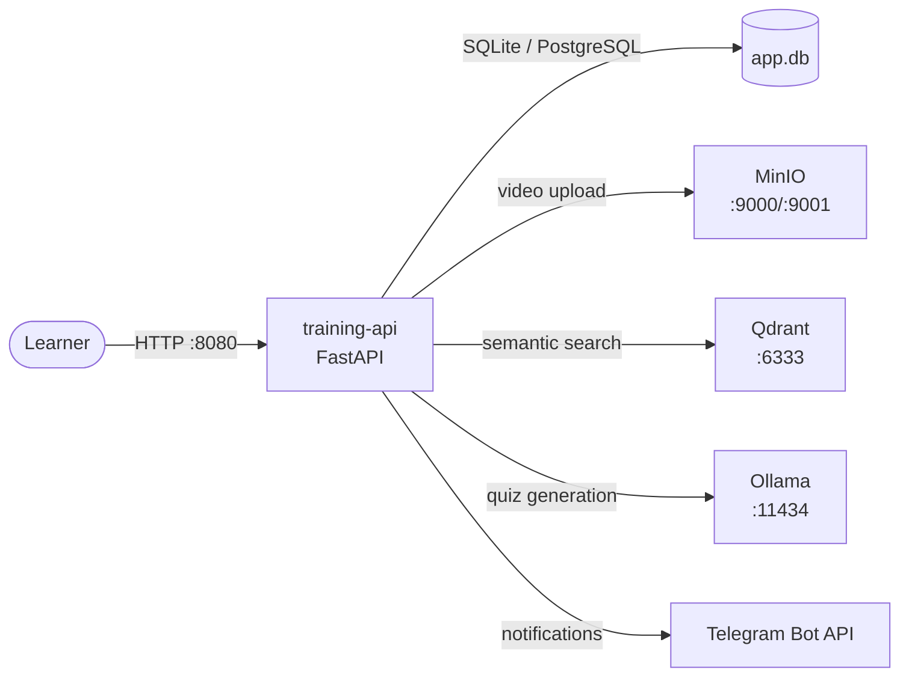

# eduvex


> Self-hosted IT training platform with learning paths, Ollama-generated quizzes, progress tracking, and MinIO video storage — zero cloud dependency.

[](https://github.com/OneByJorah/eduvex)
[](https://github.com/OneByJorah/eduvex/actions/workflows/ci.yml)
[](https://github.com/OneByJorah/eduvex/actions/workflows/docker.yml)
[](https://github.com/OneByJorah/eduvex/releases)
[](https://github.com/OneByJorah/eduvex/stargazers)


## Why this exists

Training content usually ends up scattered across slide decks, shared drives, and third-party LMS subscriptions that ship learner data to someone else's cloud. eduvex bundles learning paths, AI-generated quizzes, progress tracking, and video storage into one Compose stack that runs entirely on your own network. Learner data, quiz generation (via a local Ollama LLM), and media storage never leave your infrastructure.

## Features

- Learning paths with ordered curricula and per-path prerequisites.
- AI-generated quizzes and questions via a local Ollama LLM.
- Progress tracking at user, path, and team level with event timelines.
- Training-video upload into S3-compatible MinIO.
- Qdrant semantic search over course content.
- Telegram bot for learner notifications and interactive prompts.
- Health-checked services and one-command bootstrap via `make bootstrap`.

## Quick Start

```bash
git clone https://github.com/OneByJorah/eduvex.git
cd eduvex
cp compose.env.example .env
# edit .env: set MINIO_ROOT_PASSWORD and SECRET_KEY (see Configuration)
docker compose up -d --build
```

Open the API at **http://localhost:8080** (interactive docs at `/docs`); the MinIO console is on **http://localhost:9001**.

## Configuration

Copy `compose.env.example` to `.env` and set:

| Variable | Default | Purpose |
| --- | --- | --- |
| `MINIO_ROOT_USER` | `admin` | MinIO admin user. Change before exposing to any network. |
| `MINIO_ROOT_PASSWORD` | *(required)* | MinIO admin password. Compose refuses to start without it. |
| `SECRET_KEY` | *(required)* | FastAPI signing key. Generate with `python3 -c "import secrets; print(secrets.token_urlsafe(32))"`. |
| `DATABASE_URL` | `sqlite:///./app.db` | SQLAlchemy connection string (SQLite by default; PostgreSQL supported). |
| `TELEGRAM_BOT_TOKEN` | *(empty)* | Telegram bot token for learner notifications. Optional. |
| `TELEGRAM_ADMIN_CHAT_ID` | *(empty)* | Admin chat ID for the Telegram bot. Optional. |
| `OLLAMA_ORIGINS` | `*` | Allowed CORS origins for the Ollama endpoint. |

## Architecture



`training-api` waits for the Qdrant, MinIO, and Ollama healthchecks before starting. Only MinIO (:9000/:9001) and the API (:8080) are published, bound to `127.0.0.1`.

## Stack

Python 3.11 · FastAPI · SQLAlchemy · SQLite/PostgreSQL · Qdrant · MinIO · Ollama · Telegram Bot API · Docker Compose · Make.

## Roadmap

- [ ] Multi-tenant teams with per-team dashboards.
- [ ] Certificate generation on path completion.
- [ ] PostgreSQL as the default backend with migration scripts.
- [ ] Scheduled quiz review reminders via Telegram.

## Contributing

See [CONTRIBUTING.md](CONTRIBUTING.md). [Open an issue](https://github.com/OneByJorah/eduvex/issues) to report a bug or request a feature.

## Security

Default credentials in `compose.env.example` are for local evaluation only — set `MINIO_ROOT_PASSWORD` and `SECRET_KEY` before any network-exposed deployment. Report vulnerabilities per [SECURITY.md](SECURITY.md).

## License

MIT — see [LICENSE](LICENSE).
